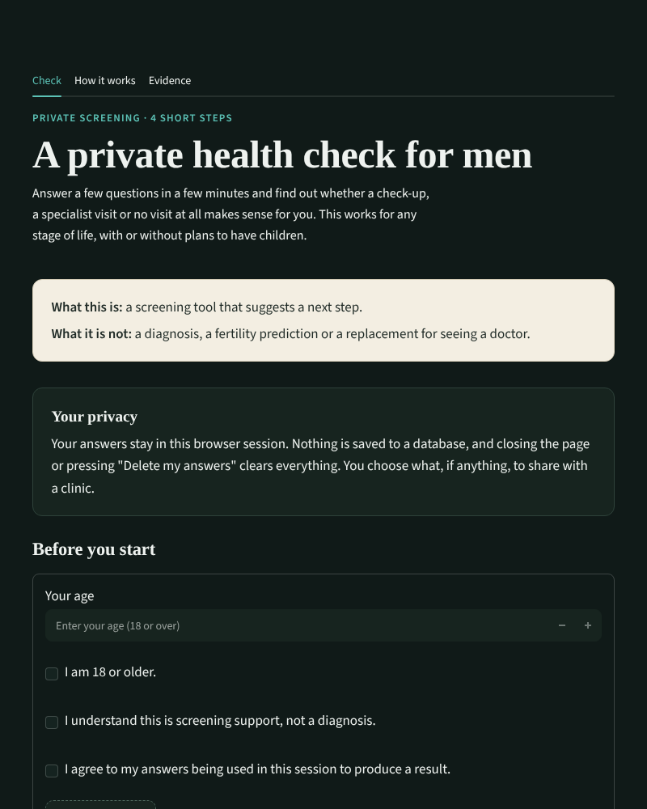
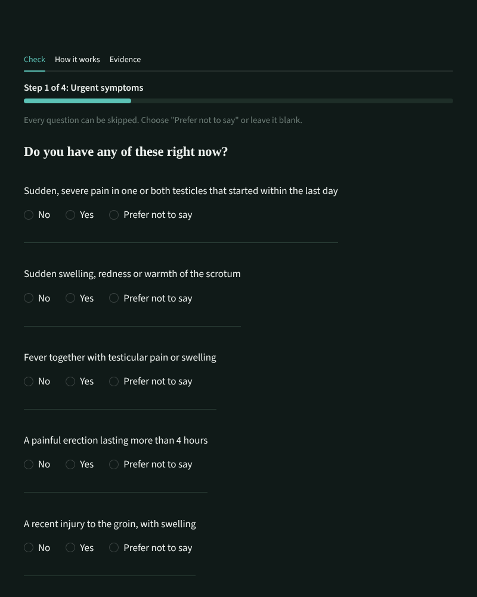

# Private Men's Health Check

**A private, rules-first screening tool that tells a man whether a check-up, a specialist visit, a fertility assessment or no visit at all makes sense, and how soon.**

Built as a prototype for the **Future Health Digital Innovation Challenge**. It runs as a [Streamlit](https://streamlit.io) app, keeps answers in the browser session only, and uses simulated data for its machine-learning second opinion.

> **Screening support only.** This is not a diagnosis, a fertility prediction or a replacement for seeing a doctor. Thresholds are design defaults awaiting clinical review, and the model is trained on a simulated population, not real patients.

<p align="center">
  
  
</p>

---

## Why it exists

Many men delay seeking help for testicular, sexual or fertility concerns because the topic feels private or awkward. This tool gives a short, anonymous first step:

- It asks only questions that change the result, and **every question can be skipped**.
- It works for any stage of life, with or without plans to have children.
- It never lets "prefer not to say" count against the user on its own.
- It gives a clear next step with a timeframe, plain-language reasons, and a summary the user can choose to share.

## How it works

1. **Safety first.** Urgent symptoms (sudden severe testicular pain, sudden swelling, fever with pain, a painful erection over 4 hours, groin injury with swelling) are checked before anything else and always override the rest. A new lump, blood in semen or an ache lasting more than two weeks routes to a prompt assessment.
2. **Transparent rules.** A written scoring protocol (`triage.py`) weighs history, health and lifestyle factors and returns one of the outcomes below.
3. **Second opinion.** A small gradient-boosted model (`model.py`) rates risk independently. If it rates **higher** than the rules, the more cautious level is used. It can never lower a result, and it cannot overrule an urgent, specialist or fertility-timing rule.
4. **You decide.** Sharing anything with a clinic is optional and tick-box controlled.

### Possible outcomes

| Outcome | Timeframe |
|---|---|
| Urgent emergency care | Today, without waiting |
| Urgent assessment | Within a few days |
| Andrology / urology visit | Next few weeks |
| Fertility assessment | Next few weeks |
| Primary care visit | Next month or so |
| Self-care, re-check later | 6 to 12 months, or sooner if anything changes |

If the age or consent requirement isn't met, the app stops with a "can't continue yet" screen.

### The second-opinion model

- 19 predictors, such as age, history, BMI, tobacco, heavy alcohol and listed medicines.
- Depth-1 boosted trees with exact additive SHAP attributions, so each result can show the factors that drove it and whether each can be changed.
- Monotone constraints: more risk factors never lower the predicted risk.
- Uses native `xgboost` when the OS allows it, and falls back automatically to a pure-NumPy implementation. It has no scikit-learn dependency, which avoids Windows Application Control DLL blocks.
- Trained at app start on a synthetic cohort (`cohort.py`, seed `20261023`). Probabilities are never shown to users, only a band and the main contributing factors.
- If the model can't load, the app keeps working in rules-only mode.

## Privacy

- Answers live only in the browser session (`st.session_state`). Nothing is written to disk or a database.
- Height and weight are used to compute BMI and are not stored.
- "Delete my answers and start again" clears the session.
- The downloadable clinician summary contains only the sections the user ticks.
- Streamlit's own usage statistics are turned off in `.streamlit/config.toml`.
- The interface loads fonts from Google Fonts. To avoid that request entirely, self-host Newsreader and Public Sans and remove the `@import` line in `app.py`.

## Quick start

Requires Python 3.10 or newer.

```bash
git clone <your-repo-url> future-health-male-triage
cd future-health-male-triage

python -m venv .venv
# Windows:  .venv\Scripts\activate
# macOS/Linux:  source .venv/bin/activate

pip install -r requirements.txt
streamlit run app.py
```

The app opens at <http://localhost:8501>.

## Project layout

```
future-health-male-triage/
├── app.py                    # Streamlit UI, design system and result rendering
├── triage.py                 # Rule engine: Intake, Triage, Band, evaluate(), compute_factors()
├── model.py                  # XGBoost / NumPy boosted-tree second opinion + cautious arbitrator
├── cohort.py                 # Simulated cohort generator used for training and evaluation
├── vignettes.py              # 60 written test vignettes
├── evaluate_report.py        # Builds EVALUATION_REPORT.md and vignettes_appendix.csv
├── EVALUATION_REPORT.md      # Shown in the app's Evidence tab
├── vignettes_appendix.csv    # Shown in the app's Evidence tab
├── test_*.py                 # pytest suites for triage, cohort, model, vignettes and the report
├── requirements.txt
└── .streamlit/
    └── config.toml           # Dark theme, accent colour, telemetry off
```

> `config.toml` must sit inside a `.streamlit` folder next to `app.py`. If it is in the project root, Streamlit will not read it.

## Using the app

The interface has three tabs:

- **Check:** a four-step guided questionnaire (urgent symptoms, about you, your history, health and lifestyle), then the result.
- **How it works:** the method, privacy and limits in plain language.
- **Evidence:** the evaluation report and the vignette appendix.

The result screen shows, in order: the recommended next step and timeframe, what to do, the factors that shaped the result (from the rules and from the model), follow-up options (a clinician summary download and a teleconsultation request, which is a demo and sends nothing), safety information, and expandable technical details.

## Testing and evaluation

```bash
pytest                       # unit tests and vignette checks
python evaluate_report.py    # regenerate EVALUATION_REPORT.md and vignettes_appendix.csv
python model.py              # print train/test metrics for the model on the simulated cohort
```

### How to read the evidence

The cohort is simulated from published estimates, and the 60 vignettes were written against the same protocol. Vignette results therefore show **agreement with the protocol**, not clinical accuracy. Sensitivity and fairness figures show how the pipeline behaves, not real-world equity. Validating on real clinical data is the main step needed before any real use.

## Design notes

The UI is built on a small set of CSS design tokens in `app.py` (colour, type scale, spacing, radii, control heights), with a charcoal-green background, a teal accent and warm off-white information cards.

- Every card sets its own background and text colours, so it reads the same in any Streamlit theme. Body text meets WCAG AA contrast.
- Urgency is always stated in words as well as colour.
- Controls are at least 44px tall, with one consistent keyboard-focus ring and reduced-motion support.
- Layout is a single reading column that adapts down to narrow phone screens.

## Limitations and next steps

- Rule thresholds are unreviewed design defaults and need clinical sign-off.
- The model is trained on simulated data only. Skipped answers are treated as neutral at inference, and the lasting fix is to simulate missingness in `cohort.py`.
- The questionnaire is English only.
- The teleconsultation flow is a mock-up.
- Next: clinical review of the protocol, validation against real-world data, localisation, and a formal accessibility audit with assistive-technology users.

## Disclaimer

This software is a research and demonstration prototype. It does not provide medical advice, diagnosis or treatment. In an emergency, contact your local emergency number or go to the nearest emergency department.
